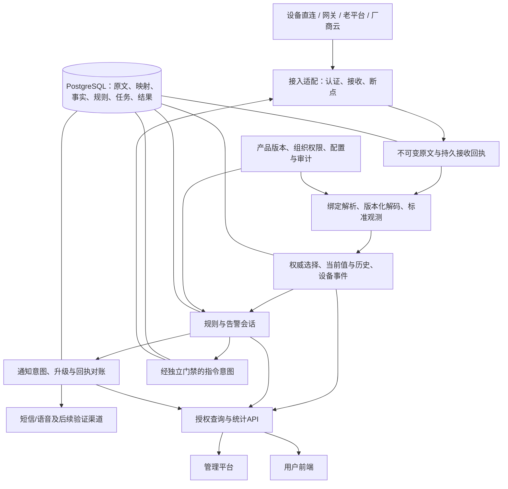
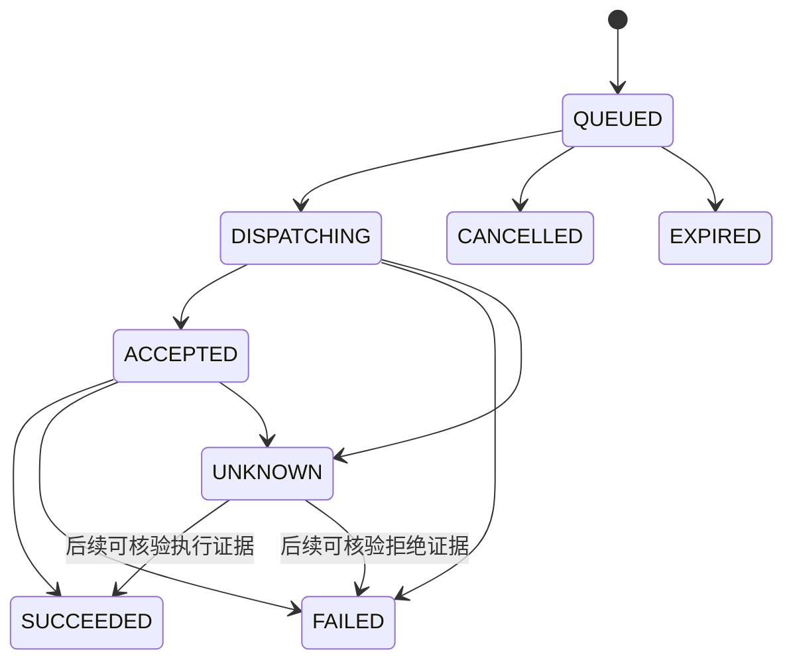

# 多厂商、多产品物联网平台：目标架构与实施方案

> 当前取证收敛以第18节剩余包为准；第16、17节保留前两轮快照，其中被更正的结论不得继续当现状或重复取证任务。服务器侧通用取证到此收敛，后续按责任方处理外部合同、裁决和许可。目标设计仍需实现及真实验收，不因材料标“已关闭”而自动启用控制或批准旧服务器关停。

> 状态：完整交付目标和领域合同已确认，当前仍需持续实现、真实接入联调与验收。目标不缩减为只读采集或本地台账；具体能力以源码和实际验收区分，不能把本轮开发完成当成全系统完成。沿用现有工程，不另起一套平行平台；真实副作用按明确目标、权限及授权执行。
>
> 当前远程记录为`20261111-iot-unified-553261ad`、V64、H2单节点，双端已采用React/Ant Design；详见[部署记录](deployment-production.md)。这不是PostgreSQL生产切库或多机验收。海康设备继续连接海康云，本平台承担统一业务和实际支持的设备操作，不要求脱云。

整体阅读与页面设计入口见[平台整体建设方案与双端页面设计](platform-delivery-plan.md)，包含管理/客户导航、关键页面组件、低保真布局、配置、数据与远程交付。本文保留详细领域合同及取证依据；页面提案不是已上线截图或完成证明。

## 1. 目标、参考和明确取舍

### 1.1 平台定位

建设“多来源接入、产品能力建模、本地资产与权限、事实处理、告警通知、双端交付”的物联网平台。消防烟感是首个行业应用，不是所有表结构和代码的固定前提。燃气、温湿度、水浸、水压/液位、电气安全、网关及有明确控制协议的执行器可复用底座；视频流、录像、计费和维保业务不因底座扩展而自动成为已接通能力。

用户需要的五部分分别落在：接入/产品/设备域；组织与归属域；规则/告警/通知域；管理与客户应用；统一数据库和运维。增加产品时，原则上新增产品定义、解析映射和应用组件配置；只有新传输/认证/报文方言才增加适配代码，不修改通用报警表来增加一个厂商分支。

完整范围按[实施方案第1.1节](platform-delivery-plan.md#11-完整接管的总验收合同用户确认)执行：旧平台已有功能迁到本平台完成实际业务，海康烟感的数据获取及型号支持的操作形成闭环，并统一为后续厂商复用的资产、产品能力、观测/事件、规则、登记和控制任务。厂家适配器是边界，不是另一套业务平台；未开发不能标成厂家不支持，保留必要连接层不能成为用户必须回旧页面操作的替代方案。

2026-11-11用户进一步确认：允许真实设备预登记、正式投运再校验资料；工程高危动作由具独立权限的平台管理员执行；新增基础维修工单闭环，不扩展服务商合同/完整维保运营。登记流程、权限、页面和验收按[实施方案第1.2节](platform-delivery-plan.md)统一执行，以下为目标，不因确认而自动调用真实业务接口。


#### 已确认的首批接入范围

| 对象 | 范围与验收边界 |
|---|---|
| 旧平台烟感 | 用户已确认14,886台台账数量，以此作为基线，不重复索取总数确认。全部纳入资产、归属、逐来源接入和原有业务功能，含离线、未激活、暂时没有上报的设备；不缩减为近期在线设备或样机。逐流接通、操作闭环及未决例外仍分别验收 |
| 海康云烟感 | 纳入账号授权范围内同型号的全部烟感。海康字典 `deviceModel=800235` 对应 HF-FY500-G，通信方式 `900002` 对应 4G。设备登记、关联、数据与型号实际支持的服务均须验收。 |
| 旧设备接入路径 | 一部分经旧平台接口转发，一部分由新平台直接从已授权来源采集；逐来源/设备记录路径、覆盖范围与生效状态，不要求首批全部脱离旧平台 |

海康接入方法及OpenAPI Key/Secret已经提供，不再将“重新提交账号或密钥”列作泛化前置条件。已有安全配置应优先复用；当前权限、有效性及真实事件能力仍按实际联调验证，本次范围确认不冒充已接通。


### 1.2 海康可借鉴什么

| 已核对的公开参考 | 可采用的设计思想 | 不能据此推断或照搬 |
|---|---|---|
| [海康消防云官网](https://www.hikfirecloud.com/)：公开页面有服务商/单位入口，面向服务机构与终端用户的应用、多个产品系列 | 设备底座与行业应用分开；实施运营与终端用户分开工作空间 | 未登录后台、内部微服务、数据库、消息队列、容量及完整页面架构均未取得 |
| [开放平台文档](https://open.hikfirecloud.com/artemis-portal/document/0)：本轮沿用已读取的137项API目录 | 设备与传感器/通道分层；资源、监测、事件、订阅、参数及操作分别建模 | 有API不等于账号有权限、具体烟感支持或本平台已接通 |
| [实时消息结构](https://open.hikfirecloud.com/artemis-portal/document/92#doc1) | 推送为主、查询补偿；不同消息流分开保存和处理 | 推送完整性、签名/ACK/重试、真实时延仍需按合同确认并实测 |

参考其分层，不复制“基础服务/值守服务”菜单，不导入海康的人工处置状态作为本地结论，也不依赖海康用户体系给客户登录。

海康已经可能完成协议解析、状态判断或报警合并。我们只能统一处理实际开放的数据，不能承诺取到云端未开放的心跳、原始字节或所有独立上报。设备内部的探测算法也不会因平台改规则而消失。

### 1.3 已确认技术路线与运行边界

用户已确认Java/Spring Boot、React＋Ant Design、双端和单位管理员有限自助，以及旧功能完整接管与多厂家归一化。保留现有工程并重构领域边界，不另起平行平台；技术栈、领域能力、真实接入和全系统验收分别记录，不能互相替代。

路线比较、许可证、迁移取舍与确认状态见[技术路线比较与双端改造提案](technology-options.md)。其余候选保留为决策依据；已确认技术目标与当前运行实现分别标记，不将设计当作验收结果。

- Java21、Spring Boot、JDBC、Flyway；沿用现有代码与领域边界，不为架构图更换ORM。
- React、TypeScript、Vite、Ant Design为当前双端主技术体系。管理/客户共用领域逻辑与数据库，受众接口、字段和授权独立；新厂家通过标准模型、适配器及能力化组件进入现有业务页，不新增一套厂家专用主后台。
- 模块化单体，Ubuntu低配单机起步；PostgreSQL17为正式事实库目标。最近部署证据仍为H2单节点，不据此声称PostgreSQL生产或多机验收。
- 不预置微服务、Kafka、Kubernetes、Redis、MinIO或Docker依赖。需要MQTT直连时才配受验证broker；厂商HTTP云接入不需要broker。
- 稳定协议适配器随平台受审代码发布；简单映射声明式配置。禁止任意JAR热加载、在线任意SQL/脚本、租户上传代码运行。
- 所有业务参数有单位、范围、作用域、生效方式和实际消费者；没有消费者的设置不对用户宣称生效。

## 2. 模块边界与运行角色



| 模块 | 唯一职责 | 不应承担 |
|---|---|---|
| 接入源/适配器 | 鉴权、设备发现、接收、分页/订阅断点、限流、传输回执 | 决定本地单位权限、直接创建报警 |
| 产品/解析 | 产品能力、版本、属性/事件/服务定义、纯解析和诊断 | 发通知、控制设备、改本地位置 |
| 资产/组织 | 本地设备、通道、位置、绑定、生命周期、授权 | 从云端名称自动猜归属 |
| 事实/投影 | 观测留存、来源选择、当前值、事件与质量 | 将未知值当正常、把收包时间当心跳 |
| 规则/告警 | 判定、会话、恢复、人工处置、计时器与决策证据 | 直接在事务里调用厂商或短信 |
| 通知 | 收件计划、发送尝试、回调/查询对账、结果 | 把API接受当送达、修改设备物理状态 |
| 指令 | 读参/写参/动作、目标版本、权限、尝试和执行证据 | 用HTTP200代替设备执行、盲重试 |
| 查询/应用 | 授权读取、过滤、统计、前端变更提示 | 浏览器重新计算另一套报警 |

各域只写自己的表；业务效果与outbox在同一本地事务。跨域调用使用明确服务端口；事务编排层能组合领域写入，不允许厂商代码随意跨表更新。

运行角色是同一应用的启动模式：`all`用于单机，`api`用于接口，`ingest`用于采集，`worker`用于解析/规则/定时/通知等任务。角色不代表独立微服务；当前已有角色分工并非已实现下述全部消费者或多机协调。

## 3. 核心实体与本地归属

### 3.1 稳定身份

- `device_id`：一个本地单位资产实例的ID，独立于厂商序列号、EUI、IMEI。该实例内位置迁移不改ID。
- `source_id`：一次独立接入实例，同时隔离厂商账号/项目/区域/凭据及断点。一个厂商多个账号建多个实例；不再增加没有独立语义的source/account双层。
- 外部资源键：`source_id + resource_kind + external_device_id + external_channel_path`。序列号是资料/别名，不是跨厂商全局主键。
- `binding_id + binding_epoch`：一次外部资源到本地设备/通道的明确绑定；结束后不可复活，用新代数重绑。
- `product_version_id`：设备采用的不可变能力定义；`integration_profile_id`：绑定采用的不可变协议/映射版本。

同一外部资源同一时段只能有一个有效本地绑定；一个本地设备可以有多个明确批准的来源，但必须配置属性/事件权威策略。不得按名称、地址、序列号相似自动认领或合并。

### 3.2 单位、位置、用户、联系人

沿用`tenants`表示本地数据所属单位；单位关系另存，不自动产生下级授权。位置按同单位`parent_place_id`构树，拒绝循环与跨单位父节点。位置筛选树不自动变成权限树；现有全单位/显式设备范围保留，不悄悄增加位置授权或用设备分组扩权。

登录用户、角色/操作权限、平台用户的单位grant、设备范围分别判定。通知联系人独立于登录用户，不能用手机号相同就自动授予账号或设备权限。海康账号仅作后台数据来源，外部company/unit/area/user仅是待映射资料。

用户资料、操作角色和数据范围在同一业务上下文维护；按单位/位置子树筛选后可批量选择明确设备并增授/移除/替换。位置筛选仍是明确设备授权快照，不隐式引入跟随树变化的动态授权。后端统一覆盖列表、详情、统计、历史、导出/附件、任务及实时通道，撤权/停用后阻断后续访问和执行；移动如需调整人员须显式预览确认，不默扩权限。


来源实例有两种可见域：

- `TENANT`：限定一个本地单位，来源认证不能跨单位入账。
- `PLATFORM`：可覆盖多个单位；原文先在平台隔离区保存，只有明确绑定后的单设备观测才能进入对应单位可见面。包含多个单位的整包原文绝不因其中一台设备可见就给客户下载。

#### 归属异常的含义与确认方式

“归属异常负责人”只是有权确认设备所属单位/位置和相关关系的业务人员，可以是用户本人或现有资产维护人员，不要求新增岗位或让每个单位另找一个人。该确认也不等于新增一种平台超级权限。

来源身份可核对、单位与位置关系完整且一致的旧资料，按已审核的映射规则保留，不要求全量逐设备手工审批；海康也通过明确外部ID映射关联本地单位/位置，不因名称相同自动合并单位或用户。仅缺失、多义、互相冲突或无法验证的关系进入已有异常清单，由有权人员确认结果、批准人和生效边界。

未确认对象保持平台侧待分配/待确认，保留原文和安全事件并进入平台侧风险关注队列，不向不确定单位展示，不丢弃也不阻塞其他正常设备。接入和迁移期间保留必要旧报警链路，不把归属未确认等同于设备无风险或允许停服。


### 3.3 生命周期与历史归属

设备档案生命周期采用有操作证据的`REGISTERED / COMMISSIONED / SUSPENDED / RETIRED`；“有过可信上报”另作激活事实，不等于安装完成。安装、移动、更换、维护、换电、退役是追加履历，每项区分设备上报/厂商资料/人工登记。不从电量百分比推算准确剩余寿命，不补造生产、安装或维修历史。

允许先预登记/待安装，投运再核验真实单位、安装位置、已发布产品版本及适用资料；齐全时可一步完成。已明确单位的登记按该单位权限管理，位置待补不妨碍有权资料维护；未明确单位时使用平台隔离的预登记/来源资源记录，不虚构单位、位置或使用无租户业务行绕过约束。进入单位资产后与原登记记录关联并保留血缘，不出现两条长期权威。未投运不等于在线、正常或无风险，原文和安全事件仍保全；旧在用接入不因新门禁停服。


同单位位置移动保存当时位置快照。跨单位不能直接`UPDATE devices.tenant_id`：受控终止旧资产实例与绑定，在目标单位新建实例并记录受限移交关联；旧事件、报警、通知留旧单位。这样不破坏现有`(tenant_id,device_id)`外键，也不让新单位看到旧单位历史。实物序列号可延续，但不能因此绕过授权。

位置整体移动必须由服务端展开位置子树及全部设备，不只处理前端可见节点或当前页；同单位树移动保留对象身份与挂载关系，更新当前层级和未来配置解析，保留历史位置快照。跨单位走独立整体移交计划并核对双方权限、绑定、风险和在途任务，本地关联组原子切换；外部登记/归属调整记录各阶段，不宣称跨平台原子回滚或未完成同步已全部成功。授权、未完工单、通知和资源账不因移位静默改写。


解绑/重绑后，已捕获的绑定、产品版本、归属代数不得用当前映射重解释。事件源时间可信时可核对历史绑定区间；时间缺失、跨移交边界、映射空档或冲突进入待确认，不能默认写入新单位。未绑定历史数据的归属须显式批准一段回填范围，默认只回填历史、不外呼。

### 3.4 网关、子设备与通道

可独立建档、授权、产生报警的子设备拥有独立`device_id`；设备上的回路/探头/输出口使用稳定`endpoint_id/channel_key`。单体烟感可只有一个默认测点，不因没有传感器清单而丢设备。

网关在线不等于子设备在线。共享网络网关作为接入基础设施管理，其承载关系不赋予任何单位权限；不同单位子设备逐个绑定。普通资产父子关系限定在同单位，跨单位的共享传输路径不是资产父子继承。

## 4. 产品物模型：属性、事件、服务

### 4.1 不以FIRE/NORMAL定义所有产品

产品分类用于筛选与应用模板；可组合能力才决定行为。定义标准语义键和命名空间，不要求所有型号都提供同一字段。

| 产品示例 | 属性示例 | 事件示例 | 可选服务，均须单独验收 |
|---|---|---|---|
| 智能烟感 | 电量、温度、烟雾测量、信号 | 火警/恢复、防拆、污染、自检 | 读参、自检、消音 |
| 燃气 | 浓度、供电、阀门状态 | 泄漏/恢复、传感器故障 | 经授权关阀 |
| 温湿度 | 温度、湿度 | 探头故障；平台超限派生事件 | 采样/上报周期配置 |
| 水浸/水压/液位 | 浸水状态、压力或液位 | 泄漏、故障；平台阈值事件 | 经协议支持的读参 |
| 电气安全 | 电流、电压、温度、剩余电流 | 电气告警、设备故障 | 经独立门禁的控制 |
| 网关/执行器 | 链路、通道/位置状态 | 子设备状态、动作结果 | 查询、动作及回执 |

这张表是模型覆盖示例，不是已经对接的型号或能力清单。

**属性定义**包含语义键、数据类型、物理量/测量口径、原单位和标准单位、可验证换算、精度/范围、缺失值、读写能力和新鲜度依据。整数/十进制/布尔/枚举/文本/有限结构分开；十进制内部BigDecimal/NUMERIC，API采用显式类型及十进制字符串，避免JS浮点丢精度。

不能仅因单位同为“%”就把电量、湿度、烟雾、气体混为同一指标；ppm、%LEL和不同烟雾测量方法不能无依据换算。信号等级、RSRP、RSSI、SNR也不是同一字段。单位未知时保留原值与未知标记，不画跨口径均值。

**事件定义**描述发生/明确解除、事件族、源代码、严重性、测点和来源事件身份，例如`fire.alarm.raised/cleared`、`gas.leak.raised/cleared`、`fault.raised/cleared`、`device.heartbeat`。没有收到事件、空列表或未知码都不是“恢复”。

**服务定义**区分平台缓存读取、设备查询、参数写入、物理动作，登记输入输出类型、风险、幂等、超时和回执证据。不能把厂商所有API自动生成为客户按钮。

### 4.2 五种版本不能混用

| 版本 | 含义 |
|---|---|
| 标准语义目录版本 | 平台统一属性、事件、服务的含义；新增语义不改变旧键定义 |
| 产品版本 | 某厂商型号/硬件变体声明的物模型与通道能力，不可变发布 |
| 接入/解析档案版本 | 厂商来源到产品语义的字段、单位、时间、事件映射与解析器指纹 |
| 厂商协议/API版本 | 实际对接方言或API合同；不能用本平台版本号替代 |
| 设备软件/固件版本 | 设备或厂商明确提供的资料，可未知，不按型号猜测 |

设备钉住产品版本，来源绑定钉住接入档案；发布新版本不自动迁移设备。简单新型号复用已有适配器和转换白名单；二进制/TLV等复杂协议由受审代码实现。既有旧JS解码器只保留在现有隔离进程中用于迁移，逐产品用真实报文等价验证后退役，不建设新的任意脚本平台。

### 4.3 能力证据与启用门禁

每个能力分别保存“文档声明、真实读取/实验室/现场验证证据、适用型号/固件/账号范围、限制、撤销记录”。解析样例通过只证明解析，不证明设备支持；禁止把合成样例灌入业务当真实设备。

属性读取、火警观察、恢复观察、读参、写参、自检、消音是不同能力。控制要求具体设备协议、适用范围、平台启用、单位授权、操作者权限及真实回执/对账全部具备。

未验证的来源事件保留并展示“来源声称/映射待核”。疑似安全事件必须进入运营关注队列，不能因能力待验证而无声丢弃；不伪装成已确认现场火灾，也不绕过审批自动物理控制。既有已批准真实接入不因增加能力目录就被统一关停，迁移须保全原门禁与在途安全事件。

## 5. 接入、原文、解析与标准观测

### 5.1 适配器合同

适配器分别实现发现、设备登记/注销、已有设备关联、推送接收、轮询、缓存参数读取、设备查询、指令提交、回执查询等能力，沿用统一任务和业务合同。厂家未支持、适配器未实现、型号/账号待核验分别标记，不提供成功空实现；厂家支持但当前未接通的能力仍属于开发范围，不能改标“不支持”而省略。运行目录的已实现声明必须有实际消费者和相应验证。

采用两种接入方式：**产品物模型接入**通过标准协议和通用驱动解析/承接属性、事件及服务；**第三方平台接口转换适配器**通过查询、推送、登记及控制API转换资产、数据和能力，允许导入或绑定产品定义，避免重复手工建模。两者共用本章及第4、6、7、8节合同，不建立两套业务模型或后台；详细路径见[实施方案第2.3节](platform-delivery-plan.md#23-归一化与后续厂家接入)。

接入后的资产、组织、授权、事实、规则、报警故障、通知、登记/控制任务、历史、导入导出和双端业务保持一致。差异通过设备型号/固件能力、实际数据、参数范围及账号授权表达；厂家不支持、尚未实现、待验证和当前权限限制分别记录。共同功能使用同一业务语义、流程及结果合同，不能仅因来自海康或旧平台而走另一套处置和权限逻辑。

接入方式与转发/直采路径正交；同一设备可绑定多个经批准来源，按能力指定数据权威及明确控制路由。命令不向多条来源广播，不因结果未知自动切换另一条路径重发。产品物模型不替代网络、厂商API或真实协议，接口适配器也不能绕过统一物模型和业务权限。


MQTT是传输，不是应用协议；LoRaWAN NS是连接/会话层，不等于一个JSON解码器。云HTTP接入不能被包装成已经具备设备直连和NS接管。

入站步骤为：认证与有界传输校验 → 持久化原文字节及接收回执 → 提交 → ACK → 异步确定性解析。认证成功但报文畸形/型号未知仍可保留诊断原文；超限/鉴权失败不返回虚假成功。HTTP在持久提交后ACK；MQTT需使用能手动ACK的客户端或可靠落盘接收机制，做不到时必须暴露可靠性缺口，不能声称已满足合同。

轮询每个来源/数据流保存游标、时间窗口和租约。页面原文持久化后才推进检查点；使用重叠查询消除边界漏取，再按稳定记录身份去重。某个流失败不把其他流标成功。推送与轮询同一个源事件通过共同来源身份收敛。

#### 5.1.1 旧平台转发与直接采集共存

第一路径由旧平台接口转发，明确记录其业务加工层级、来源身份和投递合同；第二路径由新平台适配器直接从已授权的厂商API、broker、NS输出或上游回调等来源获取。直接采集不等于全部终端改连新服务器，也不表示旧broker/NS已经迁走或旧服务器可以关停。

两条路径均进入原文、解析和标准观测处理链。接入中心逐来源/设备展示当前路径、最后成功、数据新鲜度、待接通原因及路径切换记录，不把一个总开关误当作全部旧烟感覆盖。转发与直采看到同一物理设备时，先通过明确外部键和绑定关联同一资产；原文分别留存，事件按可验证身份与权威策略关联，不能双计报警/通知，也不能只按地址、时间接近或哈希盲目吞掉事件。

切换采用明确生效边界和回退方案；历史补录/影子比对不自动触发外呼、设备控制或刷新当前存活时间。无可靠跨源关联证据时显示待关联与来源差异，不宣称精确去重或完成接管。

#### 5.1.2 接入中心：页面化配置来源与凭据

这是已确认的目标功能，首先覆盖海康，后续厂商复用同一来源配置机制；不把海康网关、Key/Secret或采集策略写死在代码、前端构建参数或仅能由运维修改的明文环境文件中。仅平台管理员的明确接入配置权限可操作，客户单位管理员不因有限自助获得厂商凭据权限。

| 页面配置组 | 内容与边界 |
|---|---|
| 来源身份 | 厂商、接入类型、实例名称、账号/项目命名空间；跨账号/项目变更应新建来源并受控重绑，不悄悄复用旧外部ID、游标或归属 |
| 连接与认证 | 受控API地址、适配器支持的认证方式、AppKey/Secret录入/替换/轮换；默认使用既有真实接入方法，不开放任意URL探测或在线代码 |
| 采集范围 | 授权单位/区域及型号筛选；首批海康以既有型号ID识别，来源范围不直接授予客户访问权限 |
| 采集策略 | 已实现数据流的同步方式、周期、分页、超时和限流/补偿参数，均有单位、范围、版本与真实消费者；不支持的能力只读标注，不显示假生效开关 |
| 推送与订阅 | 回调资料、认证配置和订阅状态按厂商实际合同建模；保存配置不自动注册生产订阅、切换上游目标或启用真实副作用 |
| 运行与诊断 | 表单校验、只读连接验证、运行启停分别展示；最近成功/失败、各流游标、新鲜度、配置版本和实际生效状态可查看，不把保存成功当作连接或业务接通 |

Secret是只写字段：允许管理员录入/替换，但查询不返回明文；留空表示不修改，清除必须显式操作并停用或标记凭据未配置，不能误清生产凭据。提交完成、退出或撤权后清除表单敏感值，浏览器不持久化。AppKey按权限脱敏，日志、审计差异和导出均不包含凭据原文。

服务端使用受控凭据存储或加密持久化，来源配置保存credential_ref和版本；主密钥独立于业务数据库及备份保管，可用服务器环境或密钥服务，不把页面管理理解为数据库明文存Secret。轮换记录操作者/时间/版本，不记录密钥值；校验、启用与生效使用当前权限及版本控制，运行任务记录实际消费版本。


### 5.2 原始身份与可变快照

区分三类内容：`DEVICE_WIRE`（设备线路载荷）、`VENDOR_API_RECORD`（厂商API记录）、`VENDOR_DERIVED`（厂商已计算业务数据）。即便存下API响应的精确字节，也不能称为设备原始协议帧。

- 不可变投递ID：同`source_id + stream + message_id`不同字节是冲突，保留证据，不覆盖。
- 可变资源/报警快照：同一个`alarmID`可能更新次数或状态；资源ID不是投递ID，应追加其来源修订/快照，不误判为冲突或新物理报警。
- 没有可信ID、序列或时间时，不能只按payload哈希吞掉重复值：相同心跳/数值可能是新的真实上报。记录弱身份与接收次数，不能宣称精确事件计数。

来源元数据不保存认证头、Cookie或明文密钥；原文可能含个人信息，按敏感数据加密/访问审计，日志和列表只显示脱敏摘要。

### 5.3 一条原文可产生多个设备、多条观测

原文 → 多次版本化解析运行 → 0..N个属性/事件观测。解析运行保存版本、原文位置、绑定快照、诊断和结果指纹。混合网关包可部分成功；未知子设备保持隔离，不阻断已识别子设备，也不能静默略过。

观测的最小公共字段：

| 字段组 | 内容 |
|---|---|
| 身份 | 观测ID、原文/解析运行引用、原文指针或二进制偏移、source/stream |
| 本地对象 | 单位、设备、测点、binding_id/epoch、产品及解析版本快照 |
| 语义 | PROPERTY/EVENT、标准键、原始代码/文本、来源事实或派生事实 |
| 值 | 显式数据类型、原始值/单位、换算值/单位、质量及错误 |
| 时间 | 源发生时间及原文、厂商接收/更新时间（若提供）、平台接收/记录时间、时间质量 |
| 顺序 | 来源事件ID、启动会话、帧计数/序列、来源修订、身份质量 |
| 执行上下文 | LIVE/CATCH_UP/BACKFILL/REPLAY、归属代数、权威/规则版本 |

结构示例，仅用于解释合同，不是实际设备或业务种子：

```json
{
  "kind": "PROPERTY",
  "key": "environment.temperature",
  "value": {"type": "decimal", "decimal": "23.40"},
  "unit": "Cel",
  "source_value": "234",
  "source_unit": "0.1Cel",
  "observed_at": "2026-01-01T00:00:00Z",
  "time_quality": "REPORTED_VALID",
  "source_record_kind": "METRIC_SAMPLE",
  "evidence": {"pointer": "/data/0/value"}
}
```

缺失时间保留null和诊断，不把received_at填进observed_at假装源时间。对有明确协议保证、允许按平台收包时间判断链路存活的直连来源，可单独记录`last_transport_contact_at`及语义证据；云查询成功永远不算设备通信。

### 5.4 重解析、回填与重放

正常重试在相同版本生成同一逻辑观测身份；新解析版本生成新的解析代数，不能把同一次物理上报重复计入趋势、次数和通知。发布投影时只选择一个已批准的解析代数。

重解析只生成候选结果，预览差异后显式采用；默认不产生通知/指令。历史回填保留源时间和迁移标记，不更新无证据的当前值，也不自动对历史火警拨电话。当前未恢复的来源报警可通过独立“当前活动状态核对”任务确认后进入实时处置，不靠把历史数据冒充LIVE。

## 6. 多来源权威、状态和时序

### 6.1 权威按能力选择，不是整个设备最后写入获胜

| 数据类别 | 默认目标规则 |
|---|---|
| 单位、位置、设备本地名称、权限、履历 | 平台拥有，外部只能提供候选资料 |
| 普通监测属性 | 明确主来源；仅在配置允许且质量/新鲜度满足时切备用，记录理由 |
| 安全事件发生 | 任一已绑定、批准映射的来源都可报告；其他来源安静不抑制首报 |
| 安全事件解除 | 限定到来源事件/测点/恢复周期；其他来源不能随意解除已有火警 |
| 配置与动作 | 每个能力一个明确下发来源，禁止多源竞写 |

重复来源的佐证关联要求明确“同一物理事件”映射；时间相近、数值相同不构成证据。保存竞争观测与选中原因。不同源时钟不能直接拿来比较谁最新。

### 6.2 独立状态轴

设备保留生命周期、激活、连接可信度、属性质量、活动告警/故障集合、维护/通知屏蔽等独立轴；人工响应和通知结果属于各自会话/任务。温湿度设备没有FIRE也能工作；离线不能清火警；维护不让设备变正常；人工“误报”结论不代替设备明确恢复。

前端主徽标由产品应用和严重性策略合成，同时保留其他轴，不把固定烟感六态扩展成全平台唯一状态字段。

### 6.3 乱序、启动与缺数据

水位按来源、设备/测点、能力或事件流保存，不能用“设备最后一条电量”挡住稍迟的火警。boot/sequence只在协议保证的同一启动会话内比较；计数回绕、重启或时钟跳变不明时标记顺序可疑，不盲判重复。

迟到数据进入历史；不得回退最新值。LIVE延迟安全事件与BACKFILL不同：仍按新鲜度、来源活动状态和事件族处理，疑似安全信号进入关注队列，不能一律因迟到无声丢弃。迟到恢复不应关掉其发生之后的新报警；必要时记冲突并追加更正证据，不改写已经发生的外呼。

离线规则必须声明依据：真实心跳、明确最后通信、或经协议验证的周期上报。没有这些证据，只能报告`NO_DATA/STALE/UNKNOWN`。来源接口故障另外告警，不能把“海康接口不可用”变成所有烟感物理离线。

无数据/持续超限采用持久计时器；到期才由worker产生一次派生事件，重启不丢计时。旧快照、历史回填不延后当前存活deadline。

## 7. 规则、报警/故障会话与人工处置

### 7.1 规则结构

采用有限、可审计的规则类型，不先做拖拽万能引擎。每条规则包含作用域、产品/能力、输入条件、触发/恢复、持续时间、归并边界、通知动作、有效期/时区、版本、启用状态和证据要求。

支持事件映射、上下限/迟滞、持续超限、数据超时、报警归并、通知升级、维护屏蔽等类型。阈值规则明确单位、样本最小质量、缺数据如何中断计时；没有新采样不能假装数值一直满足。火警等设备原生安全事件直接保留，不先等待平台测量阈值满足。

平台阈值只影响本地派生规则；改设备内部灵敏度/上报周期属于独立指令，不是保存规则的附带动作。

继承按规则类型定义：例如现有离线策略是全局→单位→设备，通知通道是单位→位置父链。不得强造所有规则通用五层覆盖。前端展示最终命中值、来源、版本和生效对象；全局发送停用/能力禁用等硬门禁优先于局部允许。

版本发布只作用于约定的新会话/新输入；已有任务钉住旧版本，不能被编辑悄悄改收件人/参数。明确停用或撤销旧版本可以取消未执行动作，需影响预览、权限、原因与审计；已有报警和已发送结果不删除。

### 7.2 四种机制分别建模

1. 传输去重：同一次投递只持久/应用一次。
2. 事实关联：多个来源证明同一事件，保留全部证据。
3. 报警归并：不同发生记录是否进入同一业务会话。
4. 通知防重：同一轮通知对同一联系人/通道/级别不重复发送。

同设备、同测点、同事件族、同恢复周期且满足明确窗口才可归并；不同设备、类型、故障码或恢复周期不默认归并。首报立即创建会话及通知意图，不等待合并窗口。跨设备事件关联只形成关联视图，不消减独立报警。

恢复后再次发生，创建新会话，即使仍在旧时间窗口内。窗口超出或类型/测点不同的发生记录按规则新开会话，旧活动会话不被静默关闭。一个设备可以有多个活动事件族及会话，不能用一个NORMAL/FIRE字段替代。

### 7.3 会话状态和证据

会话保存类别（安全告警/故障/通信/数据质量）、事件族、严重性、设备/测点、来源事件关联、首次/最后/恢复时间、发生次数依据、规则/归属快照和处置轨迹。

源活动状态`ACTIVE/RECOVERED/UNKNOWN`与人工响应`UNHANDLED/HANDLED`独立；已处理但未恢复仍显示活动。发生次数区分逐条证据计数、厂商累计次数和未知，不能把轮询次数当发生次数。

恢复仅影响对应来源身份、测点、事件族及不晚于恢复时刻的发生周期。某来源的“设备正常”不能批量关闭其他来源无关联的报警。人工处置需明确结论/备注，保留操作者和当时位置；自动恢复不写人工结论。

旧设计“火警不过滤”的安全意图与用户要求合并的兼容方式是：不丢原始事实、不压首报、不跨独立事件误合并；允许明确的会话组织和通知防重，不把归并当作删除或延迟安全信号。

### 7.4 基础维修工单

已确认范围为故障转工单、指派、维修记录、复核及设备更换，复用同一设备/单位与授权，不按厂家或接入方式另建工单系统；不新增服务商合同、完整维保计划/规范和外包SLA。维修人员使用有权登录用户，指派不创建账号或自动扩权。

工单状态与设备故障物理状态独立：源恢复不替代人工复核，人工完工不伪造恢复或终端回执。无明确恢复时保留未知/仍活动提示；更换保留新旧设备关系和各自历史。后台工作项/指令不是维修单，单据、流转和维修证据有独立实体及审计；历史导入/回放不自动建单、通知或控制。


## 8. 通知与指令：外部副作用不能伪造成功

### 8.1 通知闭环

当前SMS/VOICE真实provider是可复用基础；以后增加渠道必须独立实现provider与回执合同，不能只加枚举。

通知意图按`会话 + 通知轮次 + 规则版本 + 收件人 + 通道 + 等级`唯一。首次、周期提醒、升级分别有持久计划；到期检查当前会话、联系人、授权、通道/屏蔽及预算。延期任务不在宕机恢复时循环补打所有历史轮次。

提交状态与送达状态分开：`QUEUED / ATTEMPT_PENDING / ACCEPTED / FAILED / UNKNOWN / SUPPRESSED / CANCELLED`；送达结果只有具备证据才标`DELIVERED/CONNECTED`。没有回调不把已知ACCEPTED改成“请求结果未知”，而是标`delivery=UNCONFIRMED`。

执行顺序：业务事务写意图/outbox → worker领取 → 外呼前提交attempt → 调provider → 保存结果。外呼前后崩溃若不能证明有没有提交，attempt进入UNKNOWN，先查询对账；明确未接受的失败可有限重试，UNKNOWN不得盲重发。租约不能阻止已经离开进程的网络请求，外部exactly-once不作承诺；供应商支持幂等键时按原键重试并保存其合同证据。

回调按真实供应商合同验签、校验关联和去重，先持久再ACK，保留原始证据；重复/乱序回调不把已知送达降级。无查询/回执能力时准确显示无法确认，人工确认只记人工证据，不伪装供应商回执。

费用不足不能阻断接入、原文、报警落库和站内关注；外部通道不可用要报警，可用备用通道必须预先授权，不能承诺无限透支或假装已通知。

#### 8.1.1 短信与语音独立资源账

短信条数与语音可用次数独立账户/余额、充值、消费、冻结/返还和对账，不合并积分或自动互扣。资源账户受益用户/单位、供应商账户和计费单位明确区分；客户权益口径与供应商支出口径按真实合同配置，不将语音分钟和次数混为一体。

充值订单保存通道、账户、数量、金额与价格版本；真实支付核验或有权人工确认/凭证后入账，订单与权益流水原子且幂等，同一回调/补单不重复到账。发送前原子核验和预留相应额度，再按真实计费依据结算/释放，重试不重复扣；供应商受理、送达/接通、客户扣量和供应商计费是不同维度。费用已确定不因送达未知假退，费用未知必须有对账/差异处理入口。

保留追加式充值/消费/冻结/释放/返还/冲正及授权人工调整流水，关联订单/通知/尝试及操作者，不直接覆盖余额或篡改旧交易。缺额度不吞安全事件，不擅用另一通道余额；移位/移交不自动转账或改记历史费用。此为目标合同，本轮不下单、充值、发送或调用任何真实资金接口。


### 8.2 四类读取/操作

| 操作 | 实际含义 | 门禁 |
|---|---|---|
| CACHE_READ | 读平台缓存/已有上报 | 只读权限；明确数据时间 |
| DEVICE_QUERY | 向云/设备发查询，可能唤醒、耗电或触发通信 | 单独任务、速率/权限/审计；不能藏在GET页面加载里 |
| CONFIG_WRITE | 修改设备参数 | 能力/范围/版本/二次确认、幂等和生效回读 |
| ACTION | 自检、消音、继电器、阀门等 | 更严格风险与真实执行证据 |

`desired_config`只是平台期望/待执行目标；`reported_config`是来源回报。二者不相等时显示待确认/不一致，保存参数不直接把reported改成成功。

### 8.3 指令状态



ACCEPTED只表示云/网关受理；SUCCEEDED需要协议规定的设备执行回执或可归因的参数回读/状态证据。超时作为attempt结果保存，已发出后的超时通常意味着执行未知，不等于设备没做。设备晚到ACK可以追加收敛结果，不能因此重复执行。

入队和执行前分别核对当前单位/设备、来源绑定代数、产品/能力、操作者或规则执行授权、目标配置版本、有效期、风险许可；旧配置被替代的未发任务取消/标SUPERSEDED。已发出操作不能假装撤回。

工程高危动作（物理屏蔽/禁用、EEPROM写入等）要求平台管理员身份和独立工程权限，仍须当前设备范围、真实能力、确认、原因和审计；客户、批量、规则或维修入口不能绕过执行边界。普通消音/复核等保留独立授权与型号风险检查。此次确认不启用自动危险联动，也不授权真实设备测试。


默认不自动关阀、断电、复位或消音；危险联动需要独立策略、权限、适用设备和验收。批量控制不能通过逐条普通读权限绕过。当前无真实命令链路，在协议、回执、对账及真实设备验收完成前所有写/动作入口保持不可用。

## 9. PostgreSQL数据设计与容量

### 9.1 唯一正式真相

以下是目标数据域/建议表名，不表示已经建表；优先扩展可复用现有表，不保留新旧两个长期业务权威。

| 数据域 | 目标结构 | 要点 |
|---|---|---|
| 组织权限 | tenants/places/app_users/permissions/grants/device scopes | 保留现有ID与授权语义，同单位外键 |
| 产品 | products/product_versions/function definitions/integration profiles/capability evidence | 发布不可变、设备/绑定钉版本 |
| 来源 | ingestion_sources/source resources/source_bindings/checkpoints | 每账号命名空间、绑定历史/代数、待分配隔离 |
| 资产 | devices/device_channels/device_place_history/lifecycle history | 预登记与投运分开；未定单位登记在平台隔离区，单位资产仍保持同单位约束和历史 |
| 原文与解析 | raw_messages/parse_runs/parse diagnostics | 字节不可变、去重身份、血缘、重解析代数 |
| 遥测 | telemetry_frames/telemetry_latest/telemetry_rollups | 帧历史、按指标当前值、明确口径汇总 |
| 事件与状态 | device_events/state histories/source resolutions | 发生/解除、来源选择、可信度 |
| 告警业务 | alarms/alarm_occurrences/handling traces | 将烟感专用约束迁为事件族/类别；关联原始事实 |
| 基础维修 | repair orders/flow records/evidence/replacement links | 同单位设备与故障关联，独立指派/维修/复核/更换；不与后台work items混为同一任务 |
| 规则与任务 | rule_versions/rule_decisions/timers/outbox/work items | 固定版本、实际消费者、持久调度 |
| 外部效果 | notification intents/attempts/receipts、commands/attempts/receipts | 接受/执行/送达分离、UNKNOWN |
| 资源与计费 | resource accounts/channel balances/recharge orders/resource ledger/provider settlements | 短信/语音独立权益与余额、订单入账幂等、原子预留/扣量/返还、供应商费用和客户权益分账 |
| 治理 | audit/retention runs/migration mappings | 来源、原因、操作者、不可变历史 |

全局表、平台隔离表、单位业务表分清。单位业务行必须有tenant；有设备/测点引用的行使用同单位约束。未知来源原文放平台隔离区，不用虚构单位凑外键。复用旧`raw_messages`时要显式迁移这些约束，不能把旧非空tenant当成已经支持平台隔离。

### 9.2 遥测不采用一指标一大堆无谓重复行

观测是逻辑合同，不强制每个指标都持久成一行。相同设备/测点/采样时刻的多个属性打包成一个`telemetry_frame`，JSONB中保存有类型、单位、质量和证据指针的值；时刻不同则拆帧。事件独立行保存。

当前值用`telemetry_latest(device, endpoint, property_key)`，包含选中来源、有效值、源时间、质量、最近失败/缺失观测时间和版本；坏值不覆盖最后有效值，但必须显示最后有效值已过期/本次无效，不能刷新旧值时间。

历史趋势按指定设备、指标、时间范围查询帧并生成统一口径汇总；高频跨设备分析实际成为瓶颈后，才增加有消费者的专用投影。日/小时汇总明确单位、时区、样本数/覆盖和算法，未采样区间不补0；图表降采样不改变安全规则输入。

容量算例，仅为数据量测算，不是性能或单机容量承诺：

| 条件或结果 | 数值 |
|---|---:|
| 设备数 | 10,000 |
| 每台上报间隔 | 300秒 |
| 每次属性数 | 8 |
| 平均上报包 | 约33.33包/秒 |
| 每日报文/帧上限口径 | 2,880,000 |
| 每日属性值 | 23,040,000 |

多设备一包、源快照重复、批量API及告警突发会改变行数/峰值。必须按真实编码尺寸、索引、WAL、保留期和峰值实测，不能由平均包数推导2核机器已够。

### 9.3 索引、分区和保留

优先覆盖来源幂等、活动绑定、设备测点时间、当前值、活动告警、待执行任务、回执关联的实际查询。原文/帧不默认给整个JSON建GIN索引。

分区在真实体量需要时启用：原文按接收时间；可信观测帧可按采样时间。未知/异常源时间进入受控隔离，不允许任意未来时间自动创建无限分区；历史导入明确范围。分区唯一键/全局去重通过独立小型身份账本或兼容分区键的约束实现，不能遗漏PostgreSQL分区唯一约束限制。

原文、遥测、事件、告警、通知、审计分别配置保留策略，未批准不自动删除；不是永久保留全部遥测，也不照搬旧草案30/90/180天作为已同意值。保留可重放数据的同时核对任务、引用和合规要求；清理先试算，保全长期业务证据。幂等账本保留期不能短于重放/来源重试保证窗口，过期后准确声明无法跨该边界去重。

低配单机先用受保护本地文件处理大附件，DB存逻辑对象ID、校验与元数据，不能把本地绝对路径作为下载URL；多机前必须改为共享受控存储。设备/厂商密钥、DB备份和主机配置分别保护，数据库备份并不自动包含解密主密钥。

## 10. 事务、并发、背压和可观察性

接收、解析、业务应用、外呼各自短事务；网络不放数据库事务内。业务应用与告警/定时器/通知意图/outbox原子提交；失败整体回滚。通知当前文件spool不是事务outbox，目标将持久通知计划和对账真相统一到DB，切换前处理旧spool在途记录，不能复制两份一起发送。

worker采用数据库时钟、租约、递增fencing token、唯一effect key及CAS。旧worker失去租约后不能提交本地效果；外呼attempt已经开始则新worker不能仅凭租约过期再次发送。claim短事务使用SKIP LOCKED或经验证等价机制，锁顺序统一，避免在任务锁下反向等待单位/设备锁。

按来源限制并发、轮询QPS、分页量与重试；按来源/任务类型公平调度。历史补拉不能饿死实时告警；未解析原文不可只信任不可信body中的“火警优先”标志。磁盘/DB满、接入积压超限时拒绝或背压并暴露告警，不能先ACK后丢。是否能补拉由来源合同决定，不承诺永不丢事件。

必须监控：来源最后成功及数据新鲜度、入站持久化失败、最老未处理年龄、未知设备/解析码、各产品解析失败、规则积压、过期计时器、通知未确认/UNKNOWN、指令UNKNOWN、DB/磁盘/WAL/备份年龄、单位越权拒绝。来源接口正常与设备健康分别展示；保留trace关联从原文到告警、任务及回执。

不预设未经压测的SLA。先测“上报/接收→持久→解析→告警→provider接受→真实回执”各阶段延迟及峰值，再确定资源和运维阈值。

## 11. API、权限和双端体验

### 11.1 API边界

保留现有`/api/management`和`/api/customer`受众；统一业务查询结果。新多类型数值/物模型的破坏性合同采用明确版本迁移，所有前端调用一起切换，不能在旧数字字段偷偷改类型。

管理API涵盖产品版本、来源实例、发现/隔离、绑定、权威策略、规则版本、通知配置、原文诊断、迁移/保留/审计。客户API涵盖授权设备/测点、当前值、趋势、事件、报警/故障、处置、个人通知结果。设备查询/指令始终是POST任务，不伪装成无副作用GET。

查询参数、字段选择和指标聚合使用注册白名单，不接受客户端SQL或任意表达式。列表/统计口径一致，按完整授权范围和时间窗由服务端统计，不用当前页凑总数。

主数据增删改查、整位置子树及全部设备移动/跨单位移交、用户角色与设备范围调整、报警短信/语音接入与策略、两类资源独立充值扣量对账和业务导入导出，都是必需端到端目标，不以页面/按钮替代消费者。详细交互见[整体方案](platform-delivery-plan.md)第5.4—5.5、6.7—6.12及7.5节；执行/下载重核当前权限，失败/未知有可回查结果，不伪造历史/回执/余额。

REST是查询真相。当前head-only信号仅提示需要刷新，不是事件正文流或无漏报保证。目标增量接口需持久游标、权限检查、断点/过期全量对账；WebSocket/SSE只是优化。当前平台尚未完成该增量闭环，不能只加WS按钮便宣称实时。

### 11.2 管理平台

| 工作空间 | 主要页面与任务 |
|---|---|
| 运行中心 | 平台/单位概览、报警故障处置、监测、来源/任务健康 |
| 设备与产品 | 资产、测点、拓扑、生命周期、SIM台账、产品物模型及能力证据 |
| 接入中心 | 厂商/账号实例、发现/待分配、绑定、原文/解码诊断、游标和补拉 |
| 规则与通知 | 规则版本/命中、归并、阈值、数据超时、联系人/升级/通道/回执 |
| 组织与权限 | 单位、位置树、用户、角色、明确单位/设备授权 |
| 系统治理 | 参数、审计、保留、备份状态、发布/迁移 |

不按基础服务/值守服务分组。烟感/燃气/水压等是产品/行业应用视图，不是复制后端和数据库。现有SIM是人工业务台账，不是模拟数据，不因重构删除。

### 11.3 用户前端

工作台关注授权单位/设备的风险和待办；设备页查看及按权维护档案、预登记/安装、监测和履历；处置页记录结论；维修页完成获权派修/记录/复核；通知页显示真实结果。手机保留五底栏，维修与单位维护从现有上下文进入。

完整旧功能迁移包含单位管理员已具备的本单位设备、位置、成员、联系人和局部策略维护，不把客户前端做成只读或永久推迟这些能力。必须有明确操作/可授权限与数据范围，普通CUSTOMER账号不自动获权；厂家凭据、全局规则/解析、安全上限和跨单位授权不因此开放。物理屏蔽/禁用、EEPROM写入等工程高危仅平台管理员具独立工程权限执行；普通消音/复核按各自授权。客户使用独立受众接口复用同一用例，不借管理令牌；本段目标不表示当前客户写链路已完成。

自助配置按每个参数定义允许作用域/覆盖策略、范围与实际消费者；只有获授权的单位管理员出现“单位设置”入口。切单位、撤权和登出时取消在途请求并失效相关缓存，后端提交及实际执行时重新核验单位、设备、操作与当前策略；来源/设备数据归属与参数写权限不能混为一体。

### 11.4 模型驱动但不是任意JSON堆砌

标准组件注册表提供状态/告警卡、数值卡、趋势、离散事件轴、设备/测点表、处置表单及能力受控动作。产品版本引用平台批准的组件及显式布局，不下发可执行UI代码，不把全部未知字段直接铺成文本。

界面按高频任务而非表/API组织：设备资料抽屉、复杂登记向导、位置树与设备表联动、用户操作/可见范围选择器、上下文报警表单、短信/语音独立余额卡与充值、原页任务结果。普通编辑一屏就近完成，必要高级字段按权展开；不要求记ID或编辑JSON，不为普通查询多级确认。PC与手机分别适配，操作后保留合适上下文；易用性以实际完成任务和错误可恢复验收，不以组件数量或假数据截图衡量。


用户已确认重设计导航与核心业务页面。当前源码已安装React＋Ant Design6，管理端采用运行、设备/产品、接入、规则/通知、组织权限、系统治理六工作空间，客户保留独立五底栏。公共组件、真实位置树/设备联动、整位置移动预览、可视化设备范围选择与设备行内移位已有实现；其余目标组件与业务闭环继续按逐项实证验收，不据此宣称全部旧功能或本方案已完成。

设备列表一资产一行，主风险/来源时间/位置简洁，其余进入详情。未知值、0、过期、未提供分开显示；设备上报、云派生、本平台派生、人工资料有清楚标签。传感器通道与SMS/VOICE通知通道用不同名称。故障页解释代码/恢复/人工处理，不能只显示thing.event.faults。

跨单位操作先明确目标并预览，客户移动端只展示其业务信息；产品增加属性一般增加模板配置，不为每个厂商复制页面。

## 12. 安全与远程部署

来源认证与用户认证分开；云AppSecret、设备凭据、签名密钥只在后台受控保管和轮换，日志与查询接口不回传。平台管理员可通过第5.1.2节页面录入/替换凭据，后端加密保存或引用密钥服务；这不意味着客户可读明文或浏览器持久化。配置允许的厂商地址、协议/证书和出口范围受控维护，不接受任意URL探测内网。Webhook按供应商真实签名与重试合同校验，不臆造统一签名规则。

TLS、非root服务、最小DB权限、受保护环境文件、敏感写二次确认/原因/幂等/CAS/审计沿用。租户隔离同时覆盖普通查询、统计、导出、附件、回执、任务及变更游标；未知绑定不暴露任何其他单位资料。

单机远程部署：Nginx/TLS + 应用all + PostgreSQL17 + 必要文件目录，使用systemd，不要求Docker。broker仅在真实MQTT链路需要时增加，LoRaWAN NS只在其会话、许可和连接接管具备后决定保留/接管。

负载证明需要拆分后再按api/ingest/worker/DB角色部署到多台Ubuntu；保持一个数据库事实库、全局任务协调和稳定加密密钥。多机前必须验证竞争消费、来源轮询租约、回调路由、共享文件、断线补拉和发布回退；跨机推送不能依赖单进程广播。数据库热备/故障切换也需单独验收，不因“多机”自动成为HA。

备份覆盖PostgreSQL、附件、配置/密钥恢复程序并异地保管；执行真实恢复演练后才能宣称RPO/RTO。旧文档的目标或H2恢复记录不构成PG恢复证据。

## 13. 现有工程迁移：一套真相、逐来源切换

| 现状 | 目标改动 | 不可丢失 |
|---|---|---|
| FIRE/RECOVERY+电量产品schema | 版本化属性/事件/服务与集成档案，保留旧解码适配输入 | 原发布版本、解析证据、设备绑定 |
| device_eui全局唯一并承载外部身份 | 本地资产ID + 来源资源/绑定命名空间，重新评估唯一约束 | 旧ID、序列号/别名、引用 |
| generic单主源、Hik独立发现表、legacy独立入口 | 来源注册与绑定统一；接收和标准观测合同统一 | 来源原文、绑定历史、同步水位 |
| legacy窗口合并/Hik alarmID/generic新建 | 新输入统一经会话规则；旧历史按原事实迁移，不重新破坏性合并 | alarms ID、次数依据、恢复、人工轨迹 |
| 监测/状态读取散在各来源 | 统一frame/latest/事件查询，来源扩展留证据 | 时间、单位、数值精度、未知项 |
| 本地通知spool与DB attempts | DB意图/outbox/回执真相；在途spool先对账 | 已发送及UNKNOWN记录，避免补打 |
| 单SPA多个业务视图 | 共享授权查询与组件注册，双受众切换 | 已有范围门禁及必要客户功能 |
| 远程H2单节点 | PostgreSQL17真实迁移与恢复验收 | 现有业务/授权/审计及切换后增量 |

实施顺序与验收出口：

1. **盘点与合同固定**：复用已交三包、脱敏真实报文和字典，固定来源/产品能力矩阵、设备覆盖和数据时间口径；只对具体上游合同、语义或许可缺口补证，不再全量取证。现网照常运行，不随设计或取证开控制。
2. **身份/产品/源模型迁移**：扩展版本、命名空间、绑定代数、隔离区及元数据；旧真实功能持续可读。新解析可影子比较，但不得生成第二份业务报警、外呼或指令。
3. **统一观测和业务消费者**：按来源/设备设置明确切换栅栏与水位；旧路径只处理栅栏前数据，新路径只处理栅栏后数据。待处理记录逐一迁移；同一输入只有一个业务应用者。
4. **统一会话与通知**：迁移旧ID/来源次数和在途效果；先验证首报、归并、恢复、人工处置、UNKNOWN，再接真实回执。历史重新解析不外呼。
5. **双端切换**：API破坏性合同与调用方同批更新；产品/事件模型驱动页面，完整授权范围统计。完成后退役旧入口/worker/临时投影，不留永久兼容别名或双写。
6. **正式库与逐来源验收**：H2→PG在正式放量前完成；可提前安排，但必须对最终schema/消费者复验。停写包括接入和worker，做一致性备份、保全上游缓存/游标和在途任务；导入后核对ID、外键、时间/精度、授权、任务/回执，真实恢复演练后切流。Flyway只迁DDL，不会自动搬H2数据。
7. **扩厂商与控制**：用第二家烟感及一种非烟感验证底座；每个真实写参/动作另有协议、风险、回执及真实设备验收门禁。没有这些就保持能力未启用，不交付成功空适配器。

切换失败先冻结相关来源和副作用、保全新增数据；回退要处理切换后的增量，不能用旧库直接覆盖。生产切换窗口、设备试验与收费通知需要对应授权，不由设计文档自动授权。

## 14. 验收场景与非承诺

以下是未来实现的可观察验收合同，不是本轮已运行测试：

| 场景 | 必须观察到的结果 |
|---|---|
| 两个厂商账号外部设备ID相同 | 两个命名空间，不串设备/单位 |
| 一个网关包含不同子设备 | 正确拆分，未知子设备可追踪，其余不丢 |
| 同设备云推送与轮询 | 同一来源事件可收敛，原始证据仍可查 |
| 入站提交后ACK丢失 | 重试不重复业务效果；同不可变ID异内容冲突 |
| 相同值的两次真实上报 | 身份/序列不同则保留，不按payload哈希吞心跳 |
| 多来源一方火警一方正常 | 不按最后收到覆盖火警；冲突原因可查 |
| 电量较新、火警稍迟 | 不被设备级单水位误挡；按独立事件流处理 |
| 缺心跳或厂商接口失败 | 数据超时/来源异常，不伪造物理离线 |
| 连续火警与恢复后再报 | 首报立即；规则内归并；恢复后是新会话 |
| 两设备或两个测点同时告警 | 独立事实/会话，不因地址相同误合并 |
| 设备恢复但无人处理 | 恢复状态与未处理同时存在，不自动写结论 |
| 历史补导/重解析 | 原文/版本可查，不回退当前值、不补打电话/控制 |
| 解绑重绑或跨单位移交 | 旧消息不落新单位；旧历史授权不泄漏 |
| 规则/权限在入队后变化 | 发送前复验；不把旧任务改成新目标偷偷执行 |
| 两worker、租约过期、宕机 | 本地effect只提交一次；不靠内存锁 |
| 供应商接受、回执缺失 | 显示接受但送达未确认，不标送达或盲重发 |
| 外呼后崩溃 | UNKNOWN及对账证据，不因重领重复外呼 |
| 设备写参API成功但未执行 | 不标SUCCEEDED，保留待确认/UNKNOWN |
| 指令超时晚到ACK | 凭证据收敛，不重复下发；不改写历史attempt |
| 客户导出/下载/统计/游标 | 全部使用同一当前授权与字段限制 |
| PG迁移及故障恢复 | 原数据/ID/授权/水位/在途效果核对，实际恢复成功 |
| 第二家烟感加非烟感产品 | 复用设备/规则/API；不新增厂商专用报警列或复制整套前端 |

本轮只完成设计与现状核对，不宣称以上场景已验收；不承诺端到端exactly-once、永不丢包、所有厂商都支持实时/控制、指定硬件容量或未测SLA。

## 15. 老平台补证与当前缺口

已收到`legacy-forensics-final-20261110.zip`、`legacy-delta-20261110.zip`及`legacy-remaining-20261110.zip`。第16、17节保留历史，第18节为当前收敛结论。不再开展新一轮通用取证；[原取证提示词](legacy-platform-architecture-evidence-prompt.md)保留审计用途，后续只按责任方处理尚缺的上游合同、业务裁决、协议许可及恢复/切换验收，不重复导出已有材料。

后续未知仅按第18节的具体对象和责任方管理，不把已经交付的方法、心跳单位、字典或状态写入片段再次泛称未取得。原始接口、协议许可、业务批准、真实执行及切换恢复仍分别凭证据验收，缺失不以猜测或模拟数据补齐。

当前已知海康缺口是设备事件尚未接入、实时订阅未配置、心跳/真实最后通信/固件协议字段及具体设备参数能力未验证。v3设备查询和getTraditionMsg的只读可用性证据不自动改变现网适配器能力。

旧资料中与现状不同的MyBatis/强制Redis-MinIO/旧模拟执行/固定保留天数/未部署状态均不得继续当作当前事实。本目标设计是后续架构入口，既有实施合同在对应功能切换前继续约束生产；上线状态以源码和实际验收证据为准。

### 设计依据索引

- [现有项目范围与部署边界](../README.md)
- [当前产品版本合同](product-contract.md)、[真实通用消息应用](generic-message-apply-contract.md)
- [海康本地归属边界](hik-firecloud-local-ownership.md)、[真实通知边界](aliyun-notification.md)
- [当前设备命令不可用边界](device-command-contract.md)
- [V58远程部署记录](../artifacts/real-cutover-20261110/20261109-real-cutover-fddd8c9097/remote-final/deployment.json)
- [低配Ubuntu与分机约束](../../开发方案/详细设计/18-低配Ubuntu与分机部署实施约束.md)

## 16. 首轮老平台取证校准：`legacy-forensics-final-20261110.zip`

本节据用户提供的取证包修订设计和切换门槛，不修改包内原文件，不表示已独立登录老服务器验证。报告标“已证实”的代码/日志结论，如果原始片段未随包交付，在本平台仍按“报告引用证据”管理，不能提升为本轮端到端实测。

本节为首轮历史快照。第17节明确更正的结论优先，不能仅依据本节继续索取已经交付的字典、异常清单或NS片段。

### 16.1 完整性和证据等级

- ZIP SHA-256：`b0a0f92f45ce2306ebdc11998b4ffcff2b91c6b465e91e682d8b5334739ced63`。
- 7个成员；manifest列出的6个交付文件逐项SHA-256匹配，ZIP CRC正常；本轮没有解压执行、执行SQL或调用任何线上接口。
- 包内可解析：17行产品CSV、50行证据索引、19条JSONL样本、33条CREATE TABLE；DDL中没有FOREIGN KEY定义。
- 15条样本有非空展示字符串，其SHA-256均与对应字符串匹配；另外4条没有raw_body。匹配不证明15条都是设备原始上行，更不证明来源签名或物理设备身份。
- 原文/脱敏/部分省略/业务表重建/日志片段必须分别标记。S09—S13、S15不能冒充设备线路报文，S14省略了rawData；S16是CAT1原始HTTP缺失、S17恢复缺失、S18只有离线机制无转换样本、S19是OceanConnect/TYY body缺失。
- 原始服务器查询结果、配置、代码片段和完整日志多数只是被E01—E50索引引用，没有随包交付。校验和证明交付表示一致，不证明报告所有结论已获独立复核。

S05仍包含网关精确经纬度，不符合直接公开传播的最小化要求；不把整包复制到仓库、前端或客户资料下载区，后续共享先进一步脱敏。此问题不通过修改原包来掩盖，保留原包校验与新的脱敏说明。

### 16.2 数量必须带口径，不直接采用报告总数作迁移基线

下表“复算”仅对包内CSV或明示算式；不是重新查询老数据库。

| 项 | 包内复算/可见值 | 报告的其他值 | 设计和补证结论 |
|---|---:|---:|---|
| 产品CSV行 | 17：16条数值p_id及1条目录汇总 | E20称16个部署型号 | 实际为16个在用产品行、14个型号字符串；不能按型号字符串作为产品主键 |
| 产品目录/零设备目录 | CSV汇总及E21为83/67 | G17为77/60 | 前者内部自洽，但差异未裁决；需相同快照与过滤条件 |
| TTL/TSF设备台账 | CSV分别合计14,888/14,891 | E18同值 | 仅两份台账总量自洽，不证明逐设备一一对应或全量已接入新平台 |
| TSF在线 | CSV合计12,335 | 报告12,338 | 差3，需同一时点状态分组结果 |
| 7天消息 | CSV合计475,704 | 报告475,596 | 差108，核对窗口、过滤、消息类别及采集时点 |
| LoRaWAN设备 | CSV口径1,637 | 切换段1,659 | 差22，不能直接用报告规模宣布覆盖 |
| LoRaWAN网关/连接 | 图17、在线物理网关15、网关客户端30、NS订阅19 | 同包不同维度 | 可能是注册/在线/双客户端/订阅差异，需一张对应表，不相互替代 |
| MQTT客户端 | 分类合计69 | 报告总数70 | 1个未分类，不能由总数反推完整布线 |
| 30天下行分类 | 总338,682减自动ACK338,615减人工5，余62 | 余项未说明 | 不将其全部归成自动ACK，不推断真实执行成功率 |

CSV厂商有三种文本写法，且同型号可用不同写法；不能据此确认三个真实厂商。`access_source`中AEP/TYY/CAT1括号数字缺少列义，不得当账号ID、产品ID或来源数量。p148网关stat约占CSV消息总量的一半，采集容量必须区分网关统计与终端监测/报警，不能把每条统计消息当终端激活或事件。

### 16.3 接入不是一条TTL链：按依赖分别接管

下表链路依据报告§1、E09—E17及样本；未随包的配置/日志仍需最小片段补证。

| 逻辑来源族 | 旧链路与目标接入点 | 不可省的边界 |
|---|---|---|
| Turmass网关 | 终端帧→网关→MQTT `gateway/+/uplink`；目标解析该应用载荷 | broker客户端多为网关/内部服务，不等于直连终端；当前上游QoS0按BEST_EFFORT管理 |
| LoRaWAN | 网关载荷→broker→NS解密/会话→HTTP connector→TTL；目标接收解码后connector数据，或另行验收连接层接管 | 仅订阅Turmass主题不能取得全部LoRaWAN业务；不能用同一JSON解析器替代NS |
| AEP | 厂商云→HTTP→TTL | 独立账号/认证/字段合同；现有AEP包装样本不能覆盖所有真实载荷 |
| TYY | 厂商云→HTTP入口 | platformType及原始body仍未取得，不按共用路径猜测其账号或协议 |
| OceanConnect | 厂商云→HTTP→TTL | 原始body、订阅/多目标、认证与重试待对端确认 |
| CAT1 | 上游直接HTTP→TSF业务层，绕过TTL | 必须单独接入；上游身份、原始HTTP、心跳/恢复及改目标能力未取得 |

这是六类逻辑来源，不是写死六个实例或凭据；具体source_id仍按账号/项目/区域与认证命名空间确认。海康是独立云来源，不套用上述老平台身份。

HTTP mirror与新平台MQTT订阅是并行观察路径，依赖旧主机/broker继续存在，不代表新平台已独立承接现场连接。报告显示mirror失败只记日志、TTL转发无重试；所列502/405为入口结果，不是业务解析/入账证明。报告的broker no_subscriber累计丢弃也不能直接换算成终端告警丢失率。

因此第13节逐来源切换必须以真实控制点为边界：上游推送目标、NS connector、broker/网关连接及业务转发。保持旧连接层运行可以支持先替换业务；若目标是整台旧主机关停，则broker、NS、HTTP上游、通知及必要政务转发依赖都必须有各自验收/保留决定。不得仅凭新平台界面有数据就关闭旧主机。

### 16.4 认证链与多网关观测的补充合同

报告称CAT1原入口无鉴权、MQTT匿名/共享账号、部分云入口只用URL token；这些代码/配置结论待补直接片段。在确认前按“上游身份未验证”处理。新平台收到合法mirror token，只证明旧代理→新平台一跳，不证明设备或上游已认证。

每条观测除来源实例外增加上游认证证据和表示类型：来源认证、传输认证、端到端设备身份不能合并成一个可信布尔值。未验证来源可保存和展示来源声称的安全事件并提示运营关注，但不作为自动解除其他来源告警、授予归属或触发危险控制的唯一依据；既有安全通知策略的调整需明确审批和影响验证，不借认证改造静默停掉报警。

S08描述同一终端帧被多个网关接收。目标保留每次接收的网关/信号/时间作为接收证据，再以协议验证的终端身份、帧型、启动/会话、计数及发生语义关联同一事实。帧计数有回绕/重置/有符号表示风险，不能把fcnt或哈希单独设成全局唯一，也不能在证据不足时保证精确物理发生次数。需要原3条接收记录的最小脱敏片段，不能只凭S08摘要宣布去重已验证。

### 16.5 恢复、离线和合并：继承证据，不继承错误语义

**恢复：**S17未取得，报告引用字典/代码无独立恢复分支；这不足以断言所有产品永远没有任何恢复语义。需要逐产品核对明确解除事件或经确认的状态快照。当前正常设备状态、收到心跳、字段缺失均不自动补造历史恢复时间。

报告所称168,454条handle_time为空的历史记录，只能表达“未人工处理”，不能直接称作仍物理活动，也不能反向认定已恢复。迁移保存原始快照和处置状态；缺少恢复证据时`source_activity=UNKNOWN`。历史未知归档单独展示，不进当前已证实活动告警计数、不触发历史通知；当前设备及活动来源报警通过独立核对任务建立新证据，不能把全部历史直接关闭或全部当作实时火警。

**离线：**E28/E29报告的逻辑为存储心跳周期的`2×周期+1800秒`、另有1.5倍写入及状态排除。原周期、已放大字段、调度频率和写入覆盖条件均需直接代码/配置核对；不可笼统将其简化成所有设备固定“3倍加30分钟”。

目标拆分设备声明周期、旧平台有效周期、本平台策略和派生deadline；保留单位及消费者。旧算法在告警/未激活/屏蔽等状态的排除不能作为在线证据；CAT1没有TTL上行不能判成未激活/离线，TSF在线字段也不是心跳证明。旧状态快照与新平台按已批准依据计算的连接状态分列。

**合并：**E26报告默认180秒、单位blockTime可覆盖，节点配置值可能被运行时代码覆盖；这些均记录为旧规则证据，不把页面配置或`alarmEffectiveTime=600`直接迁为生效规则。原消费者、单位、优先级与配置历史未确认的参数保持未验证，不能用于压制或恢复告警。旧alarm_count按来源累计/合并次数保留；DDL的tinyint限制要求检查范围，不能重算成精确独立报警数。

### 16.6 身份、组织与数据库导入例外

DDL可以直接确认旧表缺少数据库外键；TSF设备主键包含`(d_id,d_status)`，EUI/外部ID不是受强制唯一保护的业务身份。TTL侧部分唯一列可空。没有唯一约束不等于已经存在重复，但导入前必须验证空值、重复与状态多行，不能把一条SELECT首行当唯一匹配。

字段映射要显式区分：TTL的`d_pid`指产品，TSF的`d_pid`指位置，TSF的`d_product_id`才指产品。相同型号有多产品行，产品关联保留旧p_id与解析版本证据；不能按型号字符串join重建外键，也不能直接把旧产品行自动等同不同硬件版本。

报告的51条产品关联差异、12个孤儿位置、5台争议归属、7台TSF独有设备缺少行级裁决清单，且集合可能重叠，不相加当异常设备总数。设备资产可先进入待核验导入区，没有可信外部资源就不建立有效binding；不虚构默认单位或外部ID。

CAT1的TTL影子台账与TSF业务台账分别保存来源证据：TTL无rx不证明现场未投用，TSF在线不证明可信通信。确认真实上游资源后才建立来源绑定和采集能力，不能将两份表直接导成两批设备。

旧JSON/属性多为TEXT，迁JSONB前必须识别合法结构、原始文本、错误和类型，不能无损声明未知文本已结构化。TSF缺少完整更新时间/归属变更轨迹时，只能保留有证据的报警位置快照与导入时归属；不能从当前位置回填多年的位置历史。旧库无可核验迁移版本时，以脱敏DDL指纹及数据例外账本建立迁移基线，不伪造schema版本。

### 16.7 通知、下行和保留的新增验收门槛

- 旧notice_log的stat列没有供应商接受/送达/接通证据；E31称代码忽略供应商Code仍需源码片段补证。迁移只保留旧本地标志，提交/送达均标未验证，不将stat=1提升成ACCEPTED或DELIVERED，也不补发历史。
- S12包含`tx_stat=1`与失败code=400，说明至少不能用通道标志认定执行成功。自动ACK和终端命令分别分类，网关应答不是终端执行回执；未分类下行不强行归入成功或失败。
- 旧监测原文是有限窗口，DDL可见日期分区不单独证明删除策略；报告的约20天保留与删除事件需补片段。多年前报警可能没有可重放原文，按历史快照迁移并标缺口，不能从业务行重建假原始报文。
- 机器内未发现备份不等于没有云备份；云快照未知、binlog也不替代全量基线。任何生产写入迁移/整机关停前，必须提供一致性基线与实际隔离恢复证据。损坏清理事件先由属主只读确认，不把修旧生产任务夹带进新平台设计实施。

在第14节追加针对性验收：多网关重复保留接收证据且不误吞新心跳；网关stat不冒充终端激活；合法mirror token不提升未认证上游的clear权限；CAT1资产未绑定仍可盘点但不显示已接通；历史未处理/恢复未知与当前活动分开；业务镜像202不冒充应用成功；迁移按相同窗口复算全部计数与例外集合。

### 16.8 下一步门槛分层，不把所有缺口说成全项目阻塞

| 工作 | 现在可推进 | 必须先补齐的条件 |
|---|---|---|
| 平台底座、模型/API/页面开发 | 按目标架构推进，使用清楚标记的合同示例，不制造业务种子 | 实现后独立测试/验收，不宣称真实厂商已接通 |
| 只读并行采集 | 沿用已授权既有路径，按来源监控和对账 | 不擅自新增共享订阅、控制或付费调用，承认QoS0和mirror缺口 |
| CAT1独立替换 | 建立来源/资产例外模型 | 上游身份、真实HTTP合同、目标控制权、认证/时间/心跳能力与真实样本 |
| LoRaWAN连接层替换 | 可先设计connector接入，保留旧NS | connector目标及字段、会话可迁移能力/许可、网关指向与回退，密钥不经报告流转 |
| 正式数据迁移与旧主机关停 | 盘点、离线演练与切换预案 | 一致性备份/恢复、逐来源独立接管、组织裁决、通知和必要外部依赖验收 |
| 任一真实控制 | 设计模型和回执状态，不开放执行 | 精确型号协议、授权、终端执行证据、UNKNOWN对账与真实设备验收 |

下一轮只补差量证据，沿用E/S/G编号；具体可转交[取证提示词第二轮](legacy-platform-architecture-evidence-prompt.md#第二轮差量补证针对-legacy-forensics-final-20261110zip)。缺失不会被补成模拟数据，也不作为开放危险控制或提前关停旧连接层的理由。

## 17. 差量取证校准与当前接管门槛：`legacy-delta-20261110.zip`

### 17.1 本轮核验范围

ZIP SHA-256：`1c3b08eb59e3fc801a16d96b5619d4f83d1ae09c8e8f885a2da21a2d937defcc`。19个普通文件；校验清单18项全部匹配，数据manifest的17项hash及字节数全部匹配，CRC正常。原包未修改，包内SQL、代码和报文均未执行，本轮没有登录老服务器、调用外部接口或验证硬件。

结构化材料实际解析为：16行产品映射、538行产品定义、74行事件码、27行来源映射、119行异常、2662行CAT1影子对照、22行统计对账及1份时间线。导出数量只证明交付覆盖，不能直接称为已支持的产品/能力数量。

本轮较首轮增加了脱敏配置/代码/日志片段，可支持更具体的接口和执行语义判断。片段未覆盖的运行态、授权、设备执行、上游控制台、云快照继续按未知管理；报告“已补”标签不替代逐项核对。

### 17.2 已闭合的模型输入与不得自动执行的导入

| 材料 | 现在可用于什么 | 仍不能据此做什么 |
|---|---|---|
| 产品/属性/服务/事件字典与Java最小片段 | 建产品草稿、字段和事件映射、解析样例及差异检查 | 自动发布全部产品、认定所有字典项都有真实输出，或宣称完整源码/引用许可已取得 |
| 来源/app/platform映射 | 区分账号来源、入口与报文方言，设计适配器配置 | 按字符串或通信枚举硬建厂商实例、把外部应用当单位权限 |
| CAT1影子对照 | 资产盘点与与TSF业务记录关联候选 | 宣称已拿到CAT1原始HTTP或可独立接管上游 |
| 行级异常清单 | 产生迁移例外账本、明确裁决对象 | 把候选关系当已批准归属并执行批量修正 |
| TL-001时间线 | 区分来源报警、后续明确正常、人工处置和通知日志 | 当作完整线路收包流、精确还原全部字段写入时刻或推广到所有产品 |

因此平台研发不再需要等待通用全量资料；可以据这些材料实现目标合同。具体适配和上线仍需按产品/来源验证，不能把取证导出直接当业务种子灌进生产。

定义覆盖也要按种类和产品区分：538行是298属性、165服务、75事件容器，覆盖14个p_id；74行是21条Alarm及53条Fault代码，覆盖15个p_id，不是同一个集合。p148/p589没有本次产品定义，p148没有事件码；不能为了覆盖数字齐全而创建虚构功能。事件码的标签/解析分类仍有冲突，例如1002072的“温度故障/温度报警”、1002012的other/Fault；映射按产品及解析版本保存原码、字典标签、实际输出和审定语义，不能仅按全局code猜类别。

### 17.3 来源身份更正：厂商、方言、入口、通信方式是四件事

首轮将`oceanconnect_turbo`当成独立OceanConnect来源过强。差量材料显示它至少用于TYY数据，独立OCC账号/租户/原始请求尚无证据。保留方言名用于解码，不据此新建一个华为云业务来源；第16节六类来源是首轮候选分类，不是必须存在的六个实例。

目标来源配置显式分开：`provider_identity`（真实提供方）、`source_account/project`（隔离命名空间）、`payload_dialect`（报文方言）、`ingress/transport`（实际传输）及`communication_type`（终端/网关联网资料）。不同提供方可复用方言，同一提供方也可有多个账号；`platfromType=mqtt`不能证明CAT1使用MQTT直连本平台，CAT1仍由HTTP直推TSF。

LoRaWAN connector候选目标、载荷字段及未见应用层重试的片段已补，网关注册/在线/pub-sub客户端/NS订阅也有不同口径的对应说明。它们支持先保留旧NS、接收其解码后HTTP的迁移方案；不证明新NS已能接管会话、网关会自动改目标或已支持第二connector。静态Mnesia/源码片段不能替代切换前运行态与授权确认。

CAT1已补入口注解、日志和业务信封：`msg`请求参数、内层params二次编码、设备ID与模组IMEI不同。HTTP Content-Type仍是推断，原始请求仍缺；不能仅凭controller接受参数就把某一种form编码宣布为实际线上合同。上游IP归属不等于平台/合同方身份。

CAT1不能被定为“仅Alarm/Fault”的完整来源：这个结论目前只覆盖device_alarm_msg所选流水。影子对照的TSF状态包含在线、离线、警报、故障、未激活；旧DDL明确1=离线、2=在线、3=警报、4=故障、5=未激活、6=屏蔽。库里有离线状态不等于上游有离线报文，last_msg_time较新也不证明有心跳；仍可能来自未归档消息、同步或处理时间更新。[INFERENCE] 存在尚未解释的状态/时间写入路径，必须核对其代码及消息类型，而不是仅按报警表消息数估容量。适配器应保留实际messageType和未知消息，不把所有输入强制解析成报警，也不预先宣称有或没有normal/heartbeat/offline能力。

### 17.4 恢复证据新增：明确正常不等于“没有收到报警”

74行事件码的`recovery_code`全部为none；这不代表所有产品永远无法报告恢复。TL-001新增的关键证据是：来源先报告火警，之后明确报告正常，人工数日后单独标记“测试”。三者是不同事实。

物模型增加逐产品的恢复证据声明：

- `EXPLICIT_CLEAR_EVENT`：协议有明确解除事件及关联身份。
- `VALIDATED_NORMAL_SNAPSHOT`：经审定字段/测点/作用域的明确正常快照，可以形成“来源报告恢复”证据。
- `NONE_OR_UNVERIFIED`：没有足够证据，活动结束时间保持未知。

正常快照必须与已绑定来源、产品/解析版本、测点、事件族和顺序规则对应；心跳、低烟雾值、空字段或另一来源正常都不自动清警。“来源报告正常”不等于现场危险已排除，也不等于人工已处理。

TL-001末段`d_status=2`按本轮统计表示旧台账“在线”，不是报警恢复字段，不能继续写作“当前物理正常”。当时明确正常的证据来自seq3的来源状态字段；seq8在线以及仍保留的last_msg_type均不能重建当前火警是否活动。

TL-001是整理后的多表时间线：seq是展示次序而非全局时间顺序，创建/通知记录显示时间早于随后展示的第二次报警。部分源时间有毫秒、接收时间只有秒；心跳源时刻与接收时刻也不同。不能按seq直接重放、不能把查询得到的alarm_count快照当作创建瞬间计数。保留原字段精度和证据位置，分别按源时间/接收时间/处理时间查询。

历史告警仍默认BACKFILL，不外呼、不自动归为当前活动；只有按上述已审定恢复合同新增的证据才用于受控重建，并保留人工处置原样。人工“测试”结论不把真实接收到的来源记录篡改成模拟数据。

### 17.5 异常清单已交付，归属裁决仍未取得

本轮119行异常有118行`adjudication=未取得`，另1行为n/a；并非119台可自动修复设备。`entity_alias`有100个不同字符串，但对象包含设备、位置和检查项，不能直接称100台异常设备，也不保证不同类别的别名具有相同去重口径。

新清单含20行296/327争议，不能继续沿用首轮5台的摘要；51行产品差异、12行孤儿位置及其他EUI/UUID独有集合也须保留各自口径，不能相加当设备总数。

51条产品差异中50条是同型号313/323目录差异，另1条323/334涉及跨型号，不能一起按“目录重复”自动合并。清单中的身份检查摘要称本快照没有空EUI/重复EUI、重复UUID或同d_id多状态行；这关闭的是该快照检查，不是为旧数据库补上唯一约束。另有同假名在两库UUID独有集合出现的候选错配，假名派生与真实身份关联未证明前不能自动认定同一物理设备。

资产导入采取“可确认字段入草稿，未裁决关系留例外”的规则。裁决记录至少含稳定对象代号、原关系、批准目标、依据、批准人/时间及revision；代码不能把candidate_relation字符串直接执行成归属。影子台账映射、EUI匹配或产品匹配可以是技术证据，不取代业务单位/位置裁决。

### 17.6 通知与控制：更正首轮过强结论

**通知：**不能再写“旧平台完全没有失败记录”。TSF的notice_msg可记录失败，差量材料给出业务余额不足记录；TCC的stat=1是另一层本地标志，两层日志不能混用。两者仍都不提供可信的供应商送达/语音接通证据。

目标通知尝试记录失败阶段：本地资源/余额门禁、供应商明确拒绝、传输不确定、送达失败分别表达。旧state/stat与err_msg按原层级保存；既不能把业务失败说成供应商已收到，也不能把业务成功说成用户已收到。历史欠费失败不自动补打，实时补偿需当前报警、新鲜度、授权、资源和幂等条件。

**下行：**差量材料给出一年窗口的人工通道成功/失败记录，首轮“人工只有少数且全失败”不能推广到全部历史。code=200、tx_stat、名为replyTerminalACK的自动记录及终端动作完成是不同证据。replyTerminalACK在材料中同时被称作自动应答和下行派发，入站/出站关联尚未证明，不能仅凭名称认定已收到网关ACK；有历史通道成功更不等于终端执行，当前真实控制入口继续保持未启用。

本平台已有控制门禁的目标设计，缺的是具体产品协议、真实执行证据和实现验收，不是再从老平台索取appKey明文。参数/服务定义和缓存读取均不当作实时回读；desired与reported仍分离。

### 17.7 旧规则有了片段，但不应复制为全平台算法

默认180秒、单位blockTime覆盖、运行时节点覆盖和未找到alarmEffectiveTime消费者的证据更具体，可建立旧策略参数目录与解析合同。未知历史配置不套用当前值重算多年告警；“未找到引用”不是对所有历史版本永远无效的证明。

心跳数据出现不同倍率，不能继续假定所有设备仅被统一放大1.5倍。保留设备上报周期、旧库有效值和本平台策略三轴，并按型号/版本确认单位、写入链和扫描/排除条件。离线依据仍不能只取台账在线态；CAT1只有报警/故障并不满足稳定周期心跳合同。

框架按能力处理当前值和派生定时器，不把某款设备的帧计数、心跳变换或旧业务状态枚举写成全平台常量。相同通信类型还可能包含网关统计，不能把统计包用于证明终端存活。

### 17.8 统计对账已改善，仍有不能自动关闭的细项

下列是本轮包内复算或不同文件的并列，均非重新查询老库：

| 项 | 当前结果 | 边界 |
|---|---|---|
| 产品行/型号/目录 | 映射16行；报告目录83、有JS63、零设备67，首轮77/60不再采用 | 字典声明不等于真实输出，目录汇总仍须保留来源快照 |
| TTL/TSF台账与TSF在线 | 产品CSV合计14,888/14,891/12,329，与新对账一致 | 新时点不能单独解释首轮同包CSV与总数的历史差异 |
| 7天上报设备 | 两份新材料均为10,250 | 不等同台账在线数或新平台已接入设备数 |
| 7天消息 | 产品CSV合计475,354；对账CSV为475,375 | 仍差21；需固定时点/窗口/产品过滤，不能直接宣布全部对平 |
| 30天下行 | 新材料338,681=338,679自动ACK+2人工 | 新窗口分类自洽，但没有原62条逐行对照，不宣称已证明旧差额成因 |
| 一年人工下行 | 报告汇总有107通道成功、22失败 | 服务分组仍按同一窗口与分类核对；不当终端执行成功率 |
| MQTT客户端 | 新摘要70含连接/断连，网关物理与pub-sub已区分 | 未有完整同快照逐项清单，不据此称旧第70个已定位 |
| mirror失败 | 已补11月2日的历史502窗口及405为GET方法的说明 | 不是当前持续故障；54条是否由其他路径补齐仍未对账 |

新报告将变化解释为“窗口变化/自然变化”是合理候选解释，但不能替代同一过滤、绝对截止时间和原行集的复核。新平台对账合同应使用固定半开时间窗、快照时刻、来源/产品/消息类别及业务应用状态；不能仅传`now()-7d`后比较先后执行的查询。

### 17.9 剩余门槛收敛为外部许可与业务确认，不再重复全量取证

| 事项 | 尚缺的最小证据/决定 | 不阻止的工作 |
|---|---|---|
| CAT1独立接管 | 上游身份、真实HTTP、认证/重试/目标权限、messageType全集及状态/last_msg_time写入路径；心跳/恢复能力不能仅从报警表判定 | 通用消息接收、来源草稿、资产盘点、业务信封解析设计 |
| AEP/TYY及可能独立OCC | 对端账号/订阅、认证、第二目标/切换及重试合同；OCC是否独立确认 | 使用已交方言与样本实现解析，不虚建来源实例 |
| LoRaWAN连接退出 | 运行态connector确认、第二目标/网关指向与NS会话迁移许可和演练方案 | 先保留旧NS、开发解码后HTTP接收 |
| 业务归属 | 对已交异常稳定代号逐项裁决，而非再导出同一批表 | 无争议资产及模型/API开发 |
| Java解析引用 | 片段可引用范围/源码授权、未覆盖协议项 | 声明式映射和受许可部分实现 |
| 正式迁移/整机关停 | 一致性全量基线、云快照/备份核验、实际恢复、全部必要链路独立承接与增量对账 | 平台开发与经授权只读并行 |
| 真实控制 | 精确型号终端回执/参数生效合同、幂等和未知结果处置、独立真实设备验收 | 指令模型、缓存展示和审计设计，不开放执行 |

“机器内未发现备份”仍不能写成“没有任何备份”；可恢复性目前是未获证据，而不是被证明不可能恢复。报告的无订阅丢弃计数不直接当终端数据丢失率；新平台202仍只代表接收层，不能替代业务应用对账。

后续只补上述外部合同/裁决/许可及必要小口径差异；字典、产品矩阵、影子台账、通用DDL和已交代码片段不再要求重新全量提交。需要变更、抓包、设备或收费试验时必须另行批准，不因取证提示词自动授权。

## 18. 服务器侧取证收敛与外部决定：`legacy-remaining-20261110.zip`

### 18.1 本轮直接核验与适用范围

ZIP SHA-256：`42011dd9b3417211f5225bfd79b48972e253d0c2683678fc2bbd69cf823f8003`。8个普通文件，校验清单7项及manifest的6项hash/字节数全部匹配，CRC正常。解析得到120行决定记录、16行恢复能力、7行事件冲突；上一轮119个异常条目均在决定表中保留，新增CAT1_SHADOW汇总1项。

本轮只读取文件、复算结构及检查文档；没有运行SQL、包内代码、线上接口或设备。代码路径和服务器聚合的证据等级是交付片段/报告，非本轮独立登录服务器或真实设备验收。文件名“闭合报告”、状态“已关闭”不能覆盖缺失证据或赋予上线批准。

### 18.2 CAT1非告警流与状态写入已可形成设计合同

新片段明确了路径：控制器→validateRequestBody→TTLEvents.parseBody→设备actor/规则链→saveDatastream。控制器路径参数不是消息类型白名单，解析依据body的parseMsg[].method。已检查的转换分支为Alarm、Fault、HearBeat、Param、Other，replyTerminalACK被该业务解析器忽略；这是处理器支持集，不是上游协议所有可能method的穷尽证明。

saveDatastream合并参数并用平台当前处理时间更新d_last_msg_time；仅Alarm/Fault进入device_alarm_msg，d_last_msg_type也只在告警/故障路径写入。离线任务另按旧阈值把状态置1。新参数聚合含“心跳上报”状态及周期，能支撑CAT1确有非告警资料/更新路径，不应再以报警流水是否为空判断设备从未上报。

目标实现据此固定：

1. 入站保留实际method及未知消息，解析为多种观测，不把CAT1适配器限定成报警专用入口。
2. 心跳、参数、其他更新分别保存；最近任意消息、最近告警、源发生时间和平台处理时间分开。
3. 不将旧库new Date()写入时间直接迁为真实最后通信；历史回灌、延迟处理不能刷新实时存活deadline。
4. d_param是合并后的缓存，字段存在不证明最近一帧同时携带全部属性；例如周期值须带来源/观察时间及有效性，而非自动覆盖本平台离线策略。
5. 保存原始HTTP仍未完成。已有业务信封、controller注解和转换路径不足以证明实际编码、字符集、认证、投递唯一性、重试或上游第二目标，独立接管仍需对端合同。

这里关闭的是“为什么报警流水之外设备时间仍更新”的设计疑问，不是CAT1已端到端接通或可关闭旧入口。

### 18.3 恢复与事件分类采用有界证据，不要求补造不存在的历史

恢复表覆盖所交16个产品行，显式recovery_code均为none；正常状态证据为12项unknown、1项code_only、1项sample_yes、1项not_usable、1项n/a。这是所检查产品/代码范围的结论，不是对所有厂商、固件或海康接口永久不存在恢复能力的证明。

- p323的TL-001可作为候选“明确正常状态”样本，不是正式解除码；必须确认其状态来自明确源字段/协议位而不是解码默认值，才能启用对应产品/测点的恢复映射。
- p223目前只有代码分支及默认正常文本，没有自然样本；默认值、字段缺失或other类型本身都不能生成解除。
- p334的other可能表示温度超限/传感器故障，不能把other统一当正常或恢复。
- 其他无证据产品的恢复时间保留未知，业务可人工处置，但不篡改物理事实。

7条事件冲突材料可用于定位原码、解析方法和字典差异；注释掉的代码不当作实际发出事件，没有字典标签也不当作无效报文。协议含义由厂商/协议维护者确认，展示与业务归类由授权负责人审定，不能由agent猜测或仅按一个全局code覆盖不同产品版本。

不再追讨已经不存在的历史恢复报文。旧历史以源事实/恢复未知/人工状态归档；当前活动事件使用新证据核对。没有旧恢复码不应被设计成永远无法迁移的硬障碍，真正门槛是新平台明确且可验收的恢复/未知/人工处理合同及当前安全处置方案。

### 18.4 决定表有了责任字段，但尚无业务批准

120行记录中119行标“需业务裁决”、1行为“已关闭”的身份检查；approved_relation、approver_code、decision_time均全部为空。不能称作已有119项业务决定，也不能把一项身份检查当成批准归属。

后续直接使用已交清单由责任人确认单位/位置、产品冲突、标识错配、网关类型和CAT1影子处理；不再要求agent导出相同CSV或搜索一个并不存在的审批结果。无争议对象可按验证范围推进，未裁决对象进入受控例外队列，不默认分配客户、不静默丢弃其安全事件。

业务数据归属裁决与协议语义/源码许可是不同责任：业务负责人不能靠批准表决定未知物理码含义，开发也不能用技术匹配擅自转移设备所有权。

### 18.5 “已关闭”的统计项仍须按数学与证据边界归档

| 项目 | 本轮可确认 | 最终处理 |
|---|---|---|
| 当前MQTT分类 | 明示分类求和67，自洽 | 当前快照分类可采用；首轮清单UUID写25，本轮解释旧70时写26，缺原会话行集则不宣称已逐条追溯，登记历史不可复核即可 |
| 固定7天对账 | 新文同时列全通道475,374、comm-type475,375、16产品475,354 | 前两项仍差1；全通道减16产品为20，comm减16产品为21。未交逐产品结果集，不能仅凭查询文本和“join/边界”说明认定已完全对平或绝无丢失 |
| 首轮下行62条 | 本轮承认没有首轮行集 | 归档为无法追溯，不用新now()结果覆盖，不反复重查制造闭合 |
| mirror历史54个502 | 时间窗、方法与旁路失败范围已有说明 | 是否其他路径补收/业务应用仍未知；由新旧平台数据责任方对账或明确记录缺口，不由上游厂商替代本平台证明 |

固定事件时间窗不等于同一数据库快照：迟到插入、不同join与不同执行时刻仍可造成差异。正式迁移验收使用固定窗口、同快照、明确产品集合和分组明细，并保留例外。历史小差异不阻塞模型/API研发；是否接受剩余历史缺口由有权责任人明确决定，不能在报告中自动消除。

### 18.6 指令与通知没有因本包升级成真实执行/送达

parseBody忽略replyTerminalACK证明的是该handler不将它当业务事件处理；单靠这个分支及方法名仍不足以证明线级方向、入站网关确认或终端动作完成。继续保存通道提交、ACK类记录、执行证据的不同级别，当前没有终端回执/可核验生效合同的动作不开放真实执行。

现有读参是缓存、服务查询是产品定义；命令expireTime字段存在不能当作已经有超时消费者、幂等或生效回读。目标方案已定义这些机制，但运行代码和真实协议尚未因此自动实现。

通知仍区分TSF业务结果、TCC调用结果、供应商接受、送达/接通；余额失败可以据实展示和治理，不能把历史失败不经新鲜度/授权核验直接补打。对现行不可验证的外部效果保留UNKNOWN/未确认，不用操作按钮或成功码遮掩。

### 18.7 当前只保留责任明确的决定与上线门槛

| 责任方 | 必须作出的决定或提供的证据 | 平台侧可并行推进 |
|---|---|---|
| CAT1/AEP/TYY等上游合同方 | 原始接入合同、实际认证/编码/重试、账号及推送目标控制权；独立OCC是否存在 | 已知信封/方言、通用采集、产品模型和隔离处理；不声称来源已完成独立接管 |
| 网关/NS属主及厂商 | 目标调整、独立认证、第二connector/会话受控迁移与回退许可 | 保留现有连接层、开发解码后接收；密钥不进入报告或前端 |
| 业务资产负责人 | 已交异常对象的批准关系与生效边界 | 无争议资产和待裁决队列，不自动改归属 |
| 厂商/协议维护者及授权方 | 事件/正常语义、必要解析源码或协议使用许可、终端回执及参数生效合同 | 受许可解析、版本化映射、能力待验证标记；无执行证据则不启用控制 |
| 运维/DBA/变更负责人 | 一致性基线、云备份核验与真实隔离恢复、逐来源切换和回退、历史缺口风险处理 | 迁移工具/演练准备和经授权只读并行，不擅自停服或关机 |

机器内未发现备份仍是证据缺失，不是已证明无云备份。旧机整体退出的门槛是所有必要连接/通知/外部依赖有明确去向、当前安全业务可运行、数据可恢复及风险已批准；不是机械要求先补齐不可追溯的全部历史报文。

本轮之后不再启动第四轮通用旧平台取证。核心架构和可实现范围已足够明确，后续转为上述责任人的合同/裁决/许可，以及对应功能的实现与验收；如新增具体协议问题，只做有对象、有目的的最小补证，不重新打全量包。
